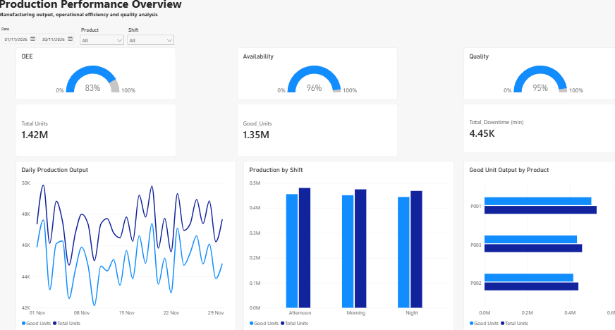
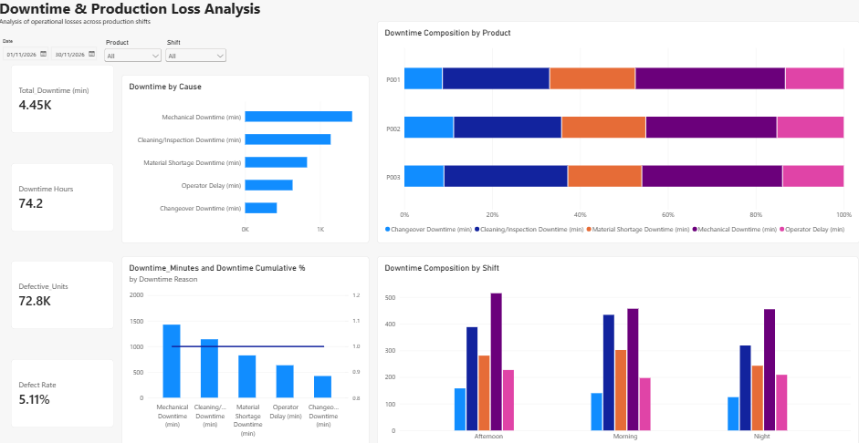

# Production Process Performance & Loss Analysis

## Overview

An independent manufacturing analytics project investigating production efficiency, operational losses and product quality across a simulated automated filling and packaging line.

The project uses Excel and Power BI to transform production records into an interactive performance dashboard, with a focus on Overall Equipment Effectiveness (OEE), downtime analysis and production output.

## Objectives

- Evaluate production performance across three products and three shifts.
- Calculate Availability, Performance, Quality and OEE.
- Identify the main contributors to production downtime.
- Compare output, defects and operational performance.
- Present findings through an interactive Power BI dashboard.

## Tools & Technologies

- Microsoft Excel: Data organisation, calculations and initial analysis.
- Power Query: Data preparation and transformation.
- Power BI: Data modelling, DAX measures and interactive visualisation.
- GitHub: Project documentation and version control.

## Dataset

The project uses a simulated dataset comprising 90 production records across 30 days and three daily shifts.

The simulated production line manufactures three products (P):

- P001
- P002
- P003

Each record includes production output, planned operating time, downtime by category, defective units and quality metrics.

**Note:** All data is simulated for educational and portfolio purposes. It does not represent actual company or manufacturing plant performance.

## Methodology

1. Structured and validated the production dataset in Excel.
2. Prepared the data using Power Query.
3. Transformed downtime categories into a separate analytical table.
4. Developed DAX measures for production performance and OEE.
5. Built interactive dashboards to compare performance by date, shift and product.
6. Investigated downtime contributions and potential operational improvement opportunities.

## Dashboard

### Production Overview

### Downtime & Loss Analysis

## Key Findings

To be completed after analysis of the final dashboard.

- Main contributor to production downtime:
- Highest-output shift:
- Product with the highest defect rate:
- Overall OEE:
- Potential operational improvement opportunity:

## Limitations

The dataset is simulated and uses assumed production conditions, downtime distributions and product characteristics. Findings should therefore be interpreted as an analytical demonstration rather than evidence of actual manufacturing performance.

## Files

- `data/`: Source dataset.
- `excel/`: Excel analysis workbook.
- `powerbi/`: Power BI report.
- `screenshots/`: Dashboard screenshots.
- `documentation/`: Supporting methodology and project notes.
